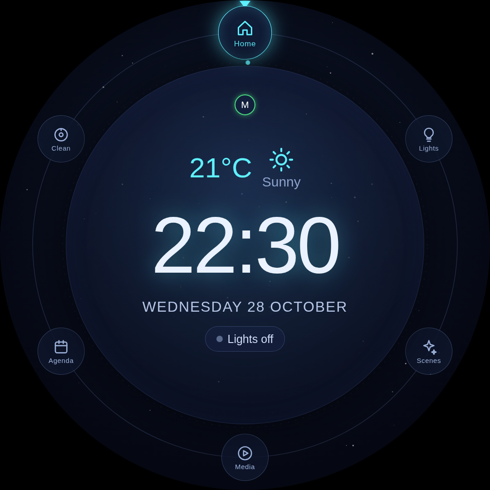
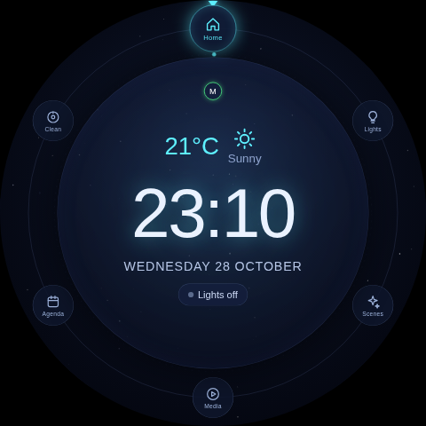
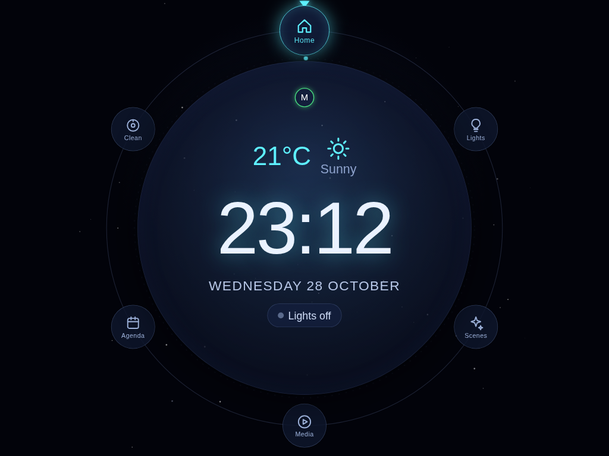
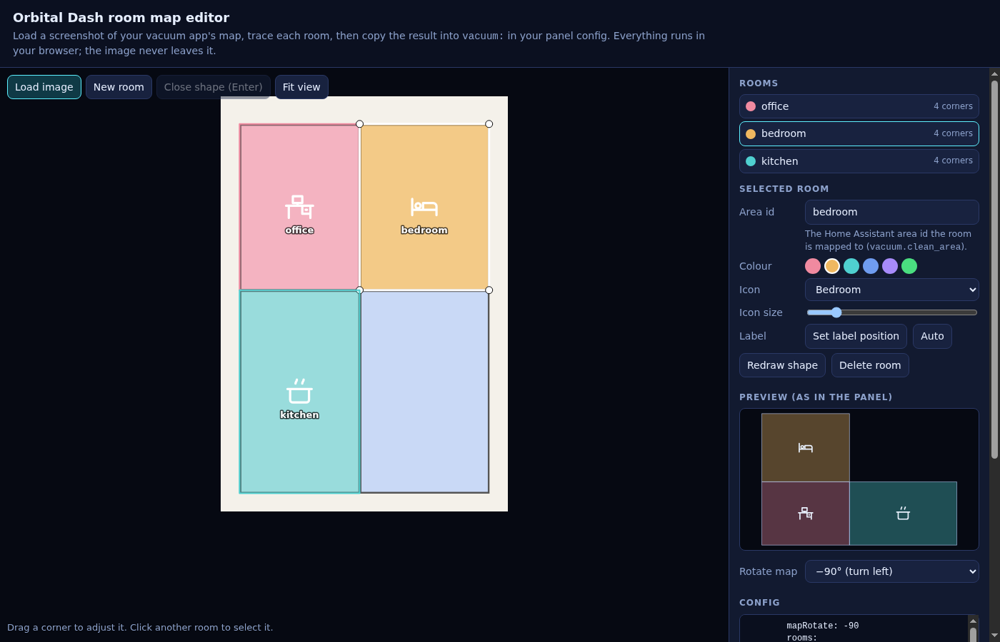

# Orbital Dash

A circular Home Assistant panel for round displays (built for a 7" 1080×1080 Waveshare HDMI panel, works in any browser). A ring of "planets" orbits the screen edge; tap or swipe to rotate the active page to 12 o'clock.



**Pages** (each appears only when it has something to show): Home (clock, weather, people, lights summary), Lights (brightness and colour), Scenes, Media (cast players, radio quick-play), Agenda (calendars, to-do, shopping), Clean (vacuum with room picker).
**Extras:** doorbell alert with "open door" button, idle screensaver, optional ambient-light-driven backlight.

> Status: built for one home and generalised afterwards. The entity-driven pages are tested with mock data; the vacuum room map is hand-drawn per home (see below). Issues and PRs welcome, but I can only test what I own.

## Install

[](https://my.home-assistant.io/redirect/hacs_repository/?owner=DiedsFou&repository=orbital-dash&category=plugin)

**HACS:** use the button above (or add this repo as a custom repository, type *Dashboard*), download it, then add the panel entry below. HACS installs the file but cannot edit `configuration.yaml` for you.
**Manual:** copy `orbital-dash.js` to `/config/www/orbital-dash/`.

Add to `configuration.yaml` (full annotated example in [`examples/configuration.yaml`](examples/configuration.yaml)):

```yaml
panel_custom:
  - name: orbital-dash
    module_url: /hacsfiles/orbital-dash/orbital-dash.js    # manual install: /local/orbital-dash/orbital-dash.js?v=1
    sidebar_title: Orbital Dash
    sidebar_icon: mdi:circle-outline
    url_path: orbital-dash
    config:
      weather: weather.home
      people: [person.alice]
      defaultLight: light.living_room
```

Restart Home Assistant once. The `module_url` above is for a HACS install; for a manual install use `/local/orbital-dash/orbital-dash.js?v=1` and, after updating the file, bump `?v=` (and restart) because the browser caches `/local` files for weeks. After a HACS update, if the old version still shows, hard-refresh the page or add `?v=2` to the `module_url` (and restart); I have not verified how HACS handles caching for `panel_custom` entries.

## Configuration

Everything lives under `config:`; all keys are optional and the full list with comments is `DEFAULTS` at the top of `orbital-dash.js`.

**Pages.** `pages: [home, lights, media]` picks the pages and their order (ids: `home`, `lights`, `scenes`, `media`, `agenda`, `vacuum`). Without it you get every page that has entities configured: no `vacuum.id` → no Clean page; no calendars/todo/shopping → no Agenda.

**Theme.** Colours, font and effects:

```yaml
config:
  theme:
    font: '"Poppins", sans-serif'
    text: "#f2f2f2"
    muted: "#a0a0b0"
    bg: ["#2a0f1a", "#14060c", "#050103"]   # centre, middle, edge of the background gradient
    stars: 40                               # 0 = none
    accents: { lights: "#ff8800", home: "#30ff90" }   # per-page colour
```

**Display size and shape.** The panel is drawn at 1080×1080 and scaled to fit, so any screen works without settings; tested at 480×480, 720×720, 1024×768 and 768×1024. On a round display leave `shape: round` (default). On a tablet or monitor use `shape: square`, which fills the whole screen with the background instead of leaving black corners (the ring and pages stay circular, centred on the shorter side). `theme.page` sets the colour around the stage if you want something else. Very small screens (under about 5 cm / 2") make the small text hard to read, because everything scales together.

| 480×480 round | 1024×768 `shape: square` |
|---|---|
|  |  |

**Language and clock.** `language` takes a locale (`en-GB`, `nl-BE`, `de`, ...) or `auto` to follow Home Assistant's language. It sets the date and time format and the labels: English and Dutch are built in, any other language falls back to English. `clock24: false` gives a 12-hour clock with a small am/pm. Fix or translate individual labels with `strings`, using the keys in `STRINGS.en` at the top of `orbital-dash.js`:

```yaml
config:
  language: de-DE
  strings:
    page_home: Zuhause
    page_lights: Lichter
    lights_off: Lichter aus
    lights_on_one: "{n} Lampe an · tippen zum Ausschalten"   # *_one / *_other pick singular or plural
    lights_on_other: "{n} Lampen an · tippen zum Ausschalten"
```

Temperatures use the unit your weather entity reports. The vacuum's area is shown as "m²" and can be changed with `strings: { vac_area: "sq ft" }`. The Dutch labels have been checked by a native speaker; corrections to any language are welcome.

**Screensaver.** After a while untouched the screen dims into an ambient mode (slowly moving clock, anti burn-in). A touch always wakes it. Everything is optional:

```yaml
config:
  screensaver:
    enabled: true            # false = never
    mode: orrery             # or nightsky
    afterMinutes: 5
    startWhen: { entity: binary_sensor.living_room_presence, state: "off" }   # only start while this holds
    wakeWhen:  { entity: binary_sensor.living_room_presence, state: "on" }    # wake as soon as this holds
```

A condition is `{ entity, state | above | below | changed }`: `state` takes one value or a list, `above`/`below` compare a numeric sensor, and `changed: true` holds for a moment each time the entity changes, which suits an event entity such as a doorbell (`wakeWhen` only). If you give several keys, all must hold. A condition on an unavailable or unknown entity does not block anything. A light sensor works through `above`/`below` (`startWhen: { entity: sensor.lux, below: 5 }`), a light through `state` (`entity: light.living_room, state: "off"`).

`ambient.entity` (a lux sensor) is a separate, older way to do the same for a dark room and also drives the backlight; both can be used together. `idleAfterMs` and `idleMode` still work for older configs.

**Checking your config.** Mistakes are reported in the browser console (look for `[orbital-dash]`): unknown options with a "did you mean", wrong value types, malformed or missing entity ids, unknown page ids. Set `showWarnings: true` to see them on the screen too.

## Vacuum

The Clean page adapts to what the vacuum entity reports in `supported_features`: Dock, Locate, Start/Pause, "Clean by room" and the "Suction & water" options only appear when the integration supports them. Older integrations work too: Start falls back to `turn_on`, Pause to `stop` or `turn_off`, and the battery is read from the entity's `battery_level` attribute when no `vacuum.battery` sensor is set. If the entity has no `supported_features` at all, every control is shown.

**Room map.** "Clean by room" needs `vacuum.rooms` and a vacuum integration with `vacuum.clean_area` (tested with Ecovacs). Build the rooms with the editor instead of tracing by hand:

1. Open [`tools/room-map-editor.html`](tools/room-map-editor.html) in a browser (download it, or open it from a clone; nothing is uploaded anywhere).
2. Load a screenshot of your vacuum app's map, press **New room** and click the corners of each room. Corners snap to neighbouring rooms, and you can drag them afterwards.
3. Give each room the Home Assistant area id it is mapped to (the same ids the vacuum's "clean areas" use), pick a colour and icon, and choose how to rotate the map. The preview shows what the panel will draw.
4. **Copy** and paste the result under `vacuum:` in your panel config.



The panel fits the map to the rooms automatically; `vacuum.mapRotate` (0, 90, -90, 180) turns it and `vacuum.mapView` overrides the view box if you want to crop. "Import existing rooms" in the editor reads a config you already have, so you can adjust it later. Without `rooms` the "Clean by room" button is hidden.

## Round display on a Raspberry Pi (optional)

[`hardware/`](hardware/) has the Pi kiosk setup: Chromium kiosk script, a backlight controller for the Waveshare round panel (HID report, small local HTTP listener, udev rule) and a systemd unit. Set `backlightUrl: http://localhost:8765/` to let the panel drive it. None of this is needed for a normal browser.

## Development

No build step: `orbital-dash.js` is a single plain script. To check a change without HA, load it in headless Chromium with a mock `hass` object (`el.panel = { config }`, `el.hass = { states, callService }`).

## Support

If Orbital Dash is useful to you, you can support its development:

[](https://buymeacoffee.com/dieds)

## License

MIT, see [LICENSE](LICENSE) (draft; confirm before publishing).
